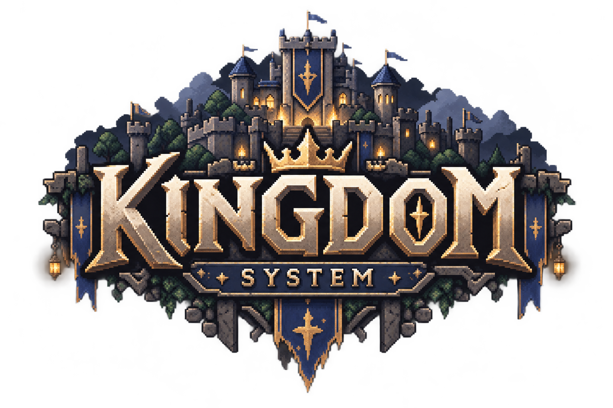

<p align="center">
  
</p>

# KINGDOM SYSTEM

2~4명이 함께 왕국을 지키는 탑다운 2D 픽셀아트 생존 게임입니다.

낮에는 시드로 만들어진 넓은 월드를 탐험하며 자원을 모으고 왕국을 건설하세요. 밤이 오면 몰려드는 몬스터와 보스의 침공을 막아내야 합니다.

장비에 깃든 스킬과 동료와의 협력으로 최종 보스를 쓰러뜨리세요. 왕국이 무너지면 모든 것이 처음부터 다시 시작됩니다.

## 실행 파일 만들기

내보내기 설정은 `export_presets.cfg`(macOS 유니버설 `.app` zip, Windows x86_64 `.exe`)에 있고, 결과물은 저장소 밖 `../kingdom-build/`에 나온다. Godot 4.7.2 내보내기 템플릿이 필요하다(에디터 Editor → Manage Export Templates, 또는 공식 릴리스의 `export_templates.tpz`).

```sh
godot --headless --path . --export-release "macOS" ../kingdom-build/macos/KingdomSystem.zip
godot --headless --path . --export-release "Windows" ../kingdom-build/windows/KingdomSystem.exe
```

- Windows는 `KingdomSystem.exe` 옆의 `libgodotsteam…dll`·`steam_api64.dll`을 함께 배포한다.
- macOS 앱은 ad-hoc 서명이라 처음 열 때 "확인되지 않은 개발자" 경고가 뜬다. 우클릭 → 열기로 연다.
- 테스트·도구·문서 폴더는 빌드에 넣지 않는다.
